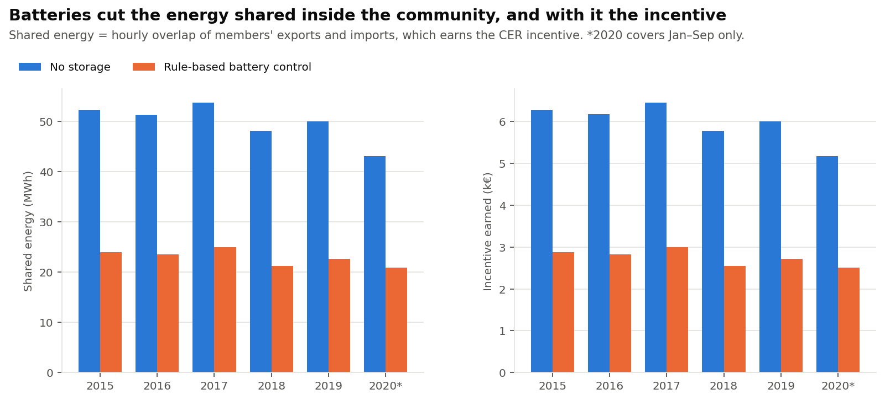
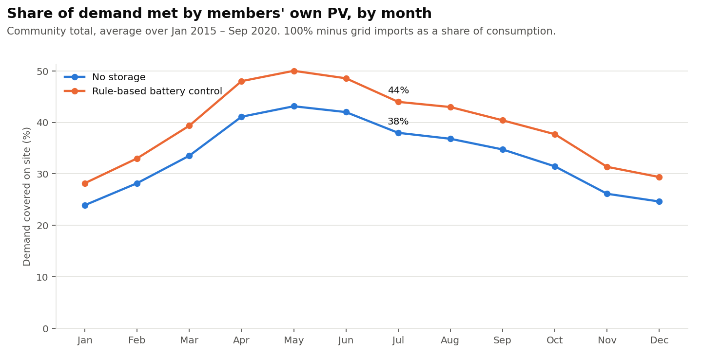
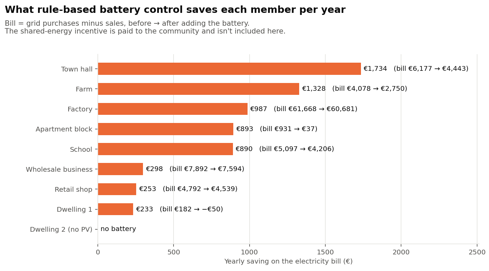
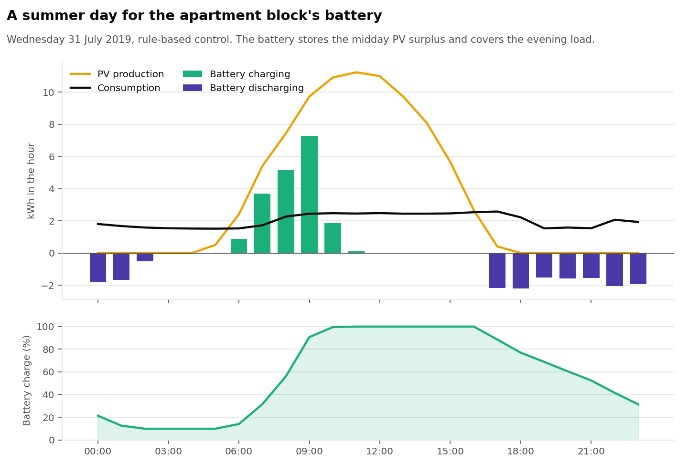

# Palermo Renewable Energy Community

A simulation of a nine-member Renewable Energy Community (REC) in Palermo,
Sicily, under the Italian incentive scheme for energy communities (Comunità
Energetiche Rinnovabili, CER). The question behind it: how should the
community's batteries be run, and who ends up saving what?

The simulator is [SmartCer](https://github.com/unisi-lab305/SmartCer), a
Gymnasium environment from the University of Siena built around the CER
incentive rules. This project was developed during an internship at the
University of Siena.

## Background

In an Italian CER, members keep their own grid connection and electricity
contract. Energy is shared virtually: in each hour, the part of the
community's exports that matches the community's imports counts as shared
energy, and the community is paid an incentive (the TIP) on it. For plants up
to 200 kW the incentive is 80 €/MWh plus a variable part that rises when the zonal price falls, capped at
120 €/MWh.

That creates a trade-off for anyone with a battery. Storing your own midday
surplus lowers your bill, but every kWh you store is a kWh you no longer
export, so less energy is shared and the community earns less incentive.
This project puts numbers on that trade-off.

## The community

| Member             | Type            | Annual demand (MWh) | PV (kW) | Battery (kWh / kW) |
| ------------------ | --------------- | ------------------: | ------: | -----------------: |
| Dwelling 1         | Household       |                 2.7 |       3 |              6 / 3 |
| Dwelling 2         | Household       |                 3.5 |       – |                  – |
| Apartment block    | Common services |                15.0 |      15 |            20 / 10 |
| School             | Public          |                55.8 |      30 |            40 / 20 |
| Town hall          | Public          |                81.7 |      50 |            60 / 30 |
| Retail shop        | Commercial      |                38.9 |      10 |           15 / 7.5 |
| Wholesale business | Commercial      |                71.0 |      20 |            30 / 15 |
| Farm               | Agricultural    |                70.5 |      45 |            40 / 20 |
| Factory            | Industrial      |               519.7 |     100 |           120 / 60 |

All members sit behind the same primary substation, which is a requirement
for sharing energy within a CER.

## Data and method

- PV production: hourly output from [PVGIS](https://re.jrc.ec.europa.eu/pvg_tools/en/)
  for Palermo (38.11 N, 13.35 E), scaled to each member's installed capacity.
- Electricity prices: hourly day-ahead prices for the Sicily bidding zone from
  [Open Power System Data](https://data.open-power-system-data.org/time_series/).
  Members sell at the zonal price and buy at the zonal price plus a fixed retail
  add-on, set so that the 2015–2020 average matches Eurostat all-in prices for
  each consumer class (0.15–0.22 €/kWh).
- Demand: the Sicily zonal load curve multiplied by an hourly profile for
  each member type (school terms and opening hours, factory shifts, shop
  hours, seasonal irrigation on the farm, and so on). Households are scaled to
  a realistic annual consumption, the others to their contracted power. The
  assumptions are in `scripts/build_consumption_profiles.py`.
- Period: January 2015 – September 2020, hourly (50,400 time steps).

Two battery strategies are compared so far:

1. No storage: batteries are left idle. This is the reference case.
2. Rule-based control: each battery charges from its owner's own PV surplus
   and discharges whenever its owner is short. SmartCer ships a controller like
   this, but it scales its actions by battery capacity while the environment
   reads them relative to rated power. With these batteries that halves every
   charge and discharge, so the project uses a corrected subclass
   (`FixedRBC` in `scripts/run_baselines.py`).

Results come from SmartCer's community-level accounting: energy bills, shared
energy and the incentive earned.

## Results

Yearly averages for the whole community:

|                        | No storage | Rule-based control |   Change |
| ---------------------- | ---------: | -----------------: | -------: |
| Grid imports (MWh)     |        568 |                518 |      −9% |
| Demand covered on site |      33.9% |              39.6% | +5.7 pts |
| Shared energy (MWh)    |       52.0 |               23.9 |     −54% |
| Electricity bill (k€)  |       91.6 |               85.0 |      −7% |
| Incentive earned (k€)  |        6.2 |                2.9 |     −54% |
| Net cost (k€)          |       85.4 |               82.1 |    −3.8% |

With batteries, the community saves about €3,200 a year overall. But more than
half of the bill saving is cancelled out by lost incentive. The batteries
absorb the midday surplus that used to be shared between members.



On-site coverage rises by 5–7 points in every month, most of all in spring
and summer:



The savings are uneven. Members with a lot of PV compared with their demand
(the town hall, the farm, the apartment block) gain the most. The factory
uses almost all of its PV directly, so its battery adds little. Dwelling 2 has
no PV or battery, so its bill doesn't change.



A typical summer day shows why the rule-based controller leaves money on the
table. The battery is full by about 10:00, and the rest of the midday surplus
goes to the grid at the wholesale price:



## Next steps

- Reinforcement learning controller. Train a Soft Actor-Critic agent on the
  community-level reward (bills plus incentive), on 2015–2018 data, and test it
  on 2019–2020. The question is whether a controller that sees the whole
  community can keep the bill savings without giving up the shared-energy
  incentive.
- Load diversity. Rerun the study for a households-only community and one or
  two in-between mixes, to measure how much a varied membership adds to shared
  energy and incentive income, and translate the results into € per member
  type.
- Sensitivity. Vary the incentive rate and battery sizes, and add battery
  investment and degradation costs to the economics.

## Limitations

- Demand profiles are modelled from a zonal load curve, not metered per member.
- Battery investment and degradation are not included, so the savings are
  operating savings only.
- The incentive is reported for the community as a whole. How it is divided
  among members is a decision for the community's own statute.
- 2020 covers January to September only.

## Reproducing the results

Requires Python 3.10.

```bash
git clone https://github.com/SristyKala1/rec_palermo_italy.git
cd rec_palermo_italy
python3.10 -m venv .venv
source .venv/bin/activate
pip install -r requirements.txt

python scripts/build_consumption_profiles.py   # member profiles -> data/config/nodes/
python scripts/run_baselines.py                # simulations -> results/simulations/ (~5 min)
python scripts/analyze_baselines.py            # summary tables -> results/, figures -> figures/
```

## Repository layout

```
data/raw/            PVGIS and OPSD source data
data/config/         community configuration (PV and battery sizes per member)
scripts/             profile building, simulation and analysis
notebooks/           walkthrough of how the demand profiles are built
results/             summary tables (hourly simulation output is not tracked)
figures/             figures used in this README
```

## References

- Stentati, M., et al. (2022). Optimization of energy
  communities in the Italian incentive system. IEEE PES ISGT Europe.
- Palma, Guiducci, Stentati, Rizzo, Paoletti (2024).
  Reinforcement Learning for Energy Community Management: A European-Scale
  Study. Energies, 17(5), 1249.
- Gjorgievski, et al. (2023). Energy sharing in European renewable energy
  communities: Impact of regulated charges. Energy, 281, 128333.
- Guiducci, L. SmartCer: A Gymnasium Environment for Renewable Energy
  Communities. https://github.com/unisi-lab305/SmartCer

## License

MIT. See [LICENSE](LICENSE).
