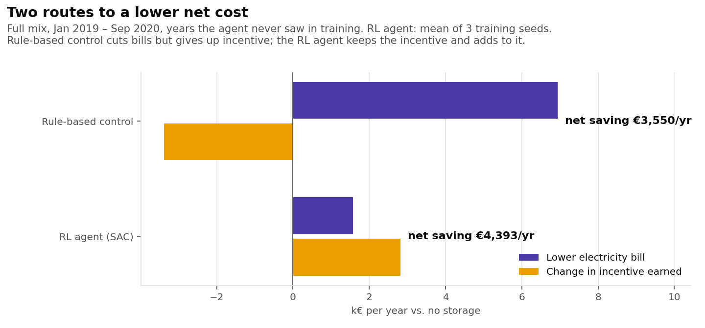
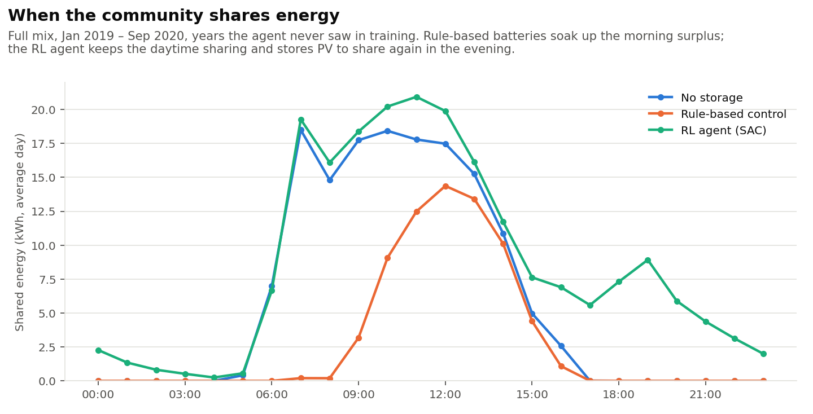
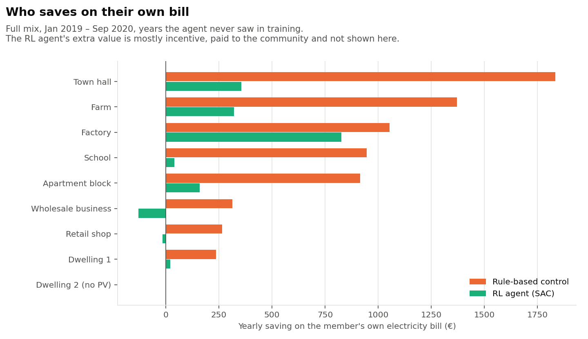
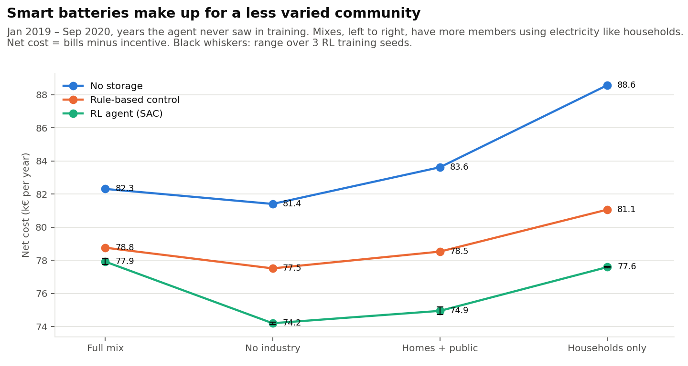

# Palermo Renewable Energy Community

A simulation of a nine-member Renewable Energy Community (REC) in Palermo,
Sicily, under the Italian incentive scheme for energy communities (Comunità
Energetiche Rinnovabili, CER). The question behind it: how should the
community's batteries be run, and who ends up saving what?

The simulator is [SmartCer](https://github.com/unisi-lab305/SmartCer), a
Gymnasium environment from the University of Siena built around the CER
incentive rules. This project was developed during an internship at the
University of Siena.

## Key findings

- Charging each battery from its owner's surplus cuts bills by 7%, but halves
  the energy shared inside the community, so the net saving is only 3.8%.
- A Soft Actor-Critic agent trained on 2015–2018 and tested on 2019–2020 saves
  €4,400 a year, against €3,550 for the simple rule. It keeps the daytime
  sharing and adds evening sharing from the batteries, so incentive income
  rises by 44%.
- Without storage, a community where everyone uses electricity like a household
  pays €6,300 a year more than the mixed one. With the RL controller the gap
  disappears.

## Background

In an Italian CER, members keep their own grid connection and electricity
contract. Energy is shared *virtually*: in each hour, the part of the
community's exports that matches the community's imports counts as **shared
energy**, and the community is paid an incentive (the TIP) on it. For plants
up to 200 kW the incentive is 80 €/MWh plus a variable part that rises when
the zonal price falls, capped at 120 €/MWh.

That creates a trade-off for anyone with a battery. Storing your own midday
surplus lowers your bill, but every kWh you store is a kWh you no longer
export, so less energy is shared and the community earns less incentive.
This project puts numbers on that trade-off.

## The community

| Member | Type | Annual demand (MWh) | PV (kW) | Battery (kWh / kW) |
|---|---|---:|---:|---:|
| Dwelling 1 | Household | 2.7 | 3 | 6 / 3 |
| Dwelling 2 | Household | 3.5 | – | – |
| Apartment block | Common services | 15.0 | 15 | 20 / 10 |
| School | Public | 55.8 | 30 | 40 / 20 |
| Town hall | Public | 81.7 | 50 | 60 / 30 |
| Retail shop | Commercial | 38.9 | 10 | 15 / 7.5 |
| Wholesale business | Commercial | 71.0 | 20 | 30 / 15 |
| Farm | Agricultural | 70.5 | 45 | 40 / 20 |
| Factory | Industrial | 519.7 | 100 | 120 / 60 |

All members sit behind the same primary substation, which is a requirement
for sharing energy within a CER.

## Data and method

- PV production: hourly output from [PVGIS](https://re.jrc.ec.europa.eu/pvg_tools/en/)
  for Palermo (38.11 N, 13.35 E), scaled to each member's installed capacity.
- Electricity prices: hourly day-ahead prices for the Sicily bidding zone from
  [Open Power System Data](https://data.open-power-system-data.org/time_series/).
  Members sell at the zonal price and buy at the zonal price plus a fixed retail
  add-on, set so that the 2015–2020 average matches Eurostat all-in prices for
  each consumer class (0.15–0.22 €/kWh).
- Demand: the Sicily zonal load curve multiplied by an hourly profile for
  each member type (school terms and opening hours, factory shifts, shop
  hours, seasonal irrigation on the farm, and so on). Households are scaled to
  a realistic annual consumption, the others to their contracted power. The
  assumptions are in `scripts/build_consumption_profiles.py`.
- Period: January 2015 – September 2020, hourly (50,400 time steps).

Three battery strategies are compared:

1. No storage: batteries are left idle. This is the reference case.
2. Rule-based control: each battery charges from its owner's own PV surplus
   and discharges whenever its owner is short. SmartCer ships a controller like
   this, but it scales its actions by battery capacity while the environment
   reads them relative to rated power. With these batteries that halves every
   charge and discharge, so the project uses a corrected subclass
   (`FixedRBC` in `scripts/run_baselines.py`).
3. Reinforcement learning (SAC): one Soft Actor-Critic agent sets all eight
   batteries every hour, rewarded on the community's hourly profit (bills plus
   incentive) compared with idle batteries. Each action is a fraction of what
   the battery can actually do in that hour, so it can't request impossible
   charges (`scripts/rl_env.py`). The agent trains on 2015–2018 and is tested
   on January 2019 – September 2020. Each result is the mean of three training
   seeds.

To test whether a varied membership matters, the study is repeated for four
community mixes (`scripts/build_mixes.py`). Every mix has the same members, PV,
batteries, tariffs and annual demand. The only change is that some members
use electricity like a household instead of following their own pattern:

| Mix | Members with a household load shape | Mean load correlation |
|---|---|---:|
| Full mix | none | 0.58 |
| No industry | factory, farm | 0.60 |
| Homes + public | also the shop and wholesale business | 0.68 |
| Households only | everyone | 0.99 |

Results come from SmartCer's community-level accounting: energy bills, shared
energy and the incentive earned.

## Results

### Rule-based control, 2015–2020

Yearly averages for the whole community:

| | No storage | Rule-based control | Change |
|---|---:|---:|---:|
| Grid imports (MWh) | 568 | 518 | −9% |
| Demand covered on site | 33.9% | 39.6% | +5.7 pts |
| Shared energy (MWh) | 52.0 | 23.9 | −54% |
| Electricity bill (k€) | 91.6 | 85.0 | −7% |
| Incentive earned (k€) | 6.2 | 2.9 | −54% |
| **Net cost (k€)** | **85.4** | **82.1** | **−3.8%** |

With batteries, the community saves about €3,200 a year overall. But more than
half of the bill saving is cancelled out by lost incentive. The batteries
absorb the midday surplus that used to be shared between members.


On-site coverage rises by 5–7 points in every month, most of all in spring
and summer:


The savings are uneven. Members with a lot of PV compared with their demand
(the town hall, the farm, the apartment block) gain the most. The factory
uses almost all of its PV directly, so its battery adds little. Dwelling 2 has
no PV or battery, so its bill doesn't change.


A typical summer day shows why the rule-based controller leaves money on the
table. The battery is full by about 10:00, and the rest of the midday surplus
goes to the grid at the wholesale price:


### A learning controller, 2019–2020 test years

Yearly averages over the test period, full mix:

| | No storage | Rule-based control | RL agent (SAC) |
|---|---:|---:|---:|
| Grid imports (MWh) | 550 | 500 | 547 |
| Shared energy (MWh) | 53 | 25 | 77 |
| Electricity bill (k€) | 88.7 | 81.8 | 87.1 |
| Incentive earned (k€) | 6.4 | 3.0 | 9.2 |
| **Net cost (k€)** | **82.3** | **78.8** | **77.9** |

The three training seeds land within €400 of each other (net cost 77.7–78.1 k€).

The RL agent takes a different route from the rule. It barely lowers grid
imports. Instead it leaves the midday surplus to be shared as before, and
uses the batteries to export again in the evening, when other members are
importing. That energy counts as shared and earns the incentive:





This changes who benefits. Under the rule, every member with a battery cuts
its own bill, by up to €1,800 a year for the town hall. Under the RL agent most
of the value is incentive, which is paid to the community, and two members
(the wholesale business and the shop) pay slightly more on their own bills.
A community running a controller like this would need a sharing rule for the
incentive that rewards members for lending their batteries.



### Does a varied membership matter?

Net cost per year over the test period, for each mix (k€):

| Mix | No storage | Rule-based control | RL agent (SAC) |
|---|---:|---:|---:|
| Full mix | 82.3 | 78.8 | 77.9 |
| No industry | 81.4 | 77.5 | 74.2 |
| Homes + public | 83.6 | 78.5 | 74.9 |
| Households only | 88.6 | 81.1 | 77.6 |

Without storage, diversity pays: when every member follows a household
pattern, shared energy halves (53 → 25 MWh a year) and net cost rises by
€6,300. The rule-based batteries narrow the gap to €2,300. The RL agent closes
it. In a community with similar load profiles nobody uses the midday surplus,
so the agent stores more of it and shares it in the evening. Its batteries
discharge 94 MWh a year in the households-only mix against 55 MWh in the full
mix.

One exception: the no-industry mix is slightly cheaper than the full mix in
every strategy. The factory's daytime load already absorbs its own PV, while
with a household shape it has surplus to share and the largest battery to
store it in.



## Next steps

- Solve the same problem as a linear program with perfect foresight, to see
  how close the RL agent gets to the best possible schedule.
- Compare rules for dividing the incentive among members, so that every member
  gains under the RL controller.
- Vary the incentive rate and battery sizes, and add battery investment and
  degradation costs.

## Limitations

- Demand profiles are modelled from a zonal load curve, not metered per member.
- Battery investment and degradation are not included, so the savings are
  operating savings only.
- The incentive is reported for the community as a whole. How it is divided
  among members is a decision for the community's own statute.
- 2020 covers January to September only.
- The household load shape is the Sicily zonal load curve, so the
  households-only mix is a stylised case rather than real household data.
- The RL agent uses the default SAC settings from stable-baselines3 and
  300,000 training steps. It was not tuned, so its results are a lower bound
  on what a learning controller can do.

## Reproducing the results

Requires Python 3.10.

```bash
git clone https://github.com/SristyKala1/rec_palermo_italy.git
cd rec_palermo_italy
python3.10 -m venv .venv
source .venv/bin/activate
pip install -r requirements.txt

python scripts/build_consumption_profiles.py   # member profiles -> data/config/nodes/
python scripts/run_baselines.py                # simulations -> results/simulations/ (~5 min)
python scripts/analyze_baselines.py            # summary tables -> results/, figures -> figures/

python scripts/build_mixes.py                  # other community mixes -> data/mixes/
python scripts/train_sac.py --mix full --seed 42   # one RL run, ~35 min on a laptop CPU
python scripts/analyze_rl.py                   # test-year tables and figures
```

The RL results use every mix (`full`, `no_industry`, `homes_and_public`,
`households_only`) with seeds 42, 7 and 123. Tests: `pytest tests/`.

## Repository layout

```
data/raw/            PVGIS and OPSD source data
data/config/         community configuration (PV and battery sizes per member)
scripts/             profile building, simulation, RL training and analysis
tests/               checks on the battery controllers and the RL wrapper
notebooks/           walkthrough of how the demand profiles are built
results/             summary tables (hourly simulation output is not tracked)
figures/             figures used in this README
```

## References

- Stentati, M., et al. (2022). Optimization of energy
  communities in the Italian incentive system. *IEEE PES ISGT Europe*.
- Palma, Guiducci, Stentati, Rizzo, Paoletti (2024).
  Reinforcement Learning for Energy Community Management: A European-Scale
  Study. *Energies*, 17(5), 1249.
- Gjorgievski, et al. (2023). Energy sharing in European renewable energy
  communities: Impact of regulated charges. *Energy*, 281, 128333.
- Guiducci, L. SmartCer: A Gymnasium Environment for Renewable Energy
  Communities. https://github.com/unisi-lab305/SmartCer
